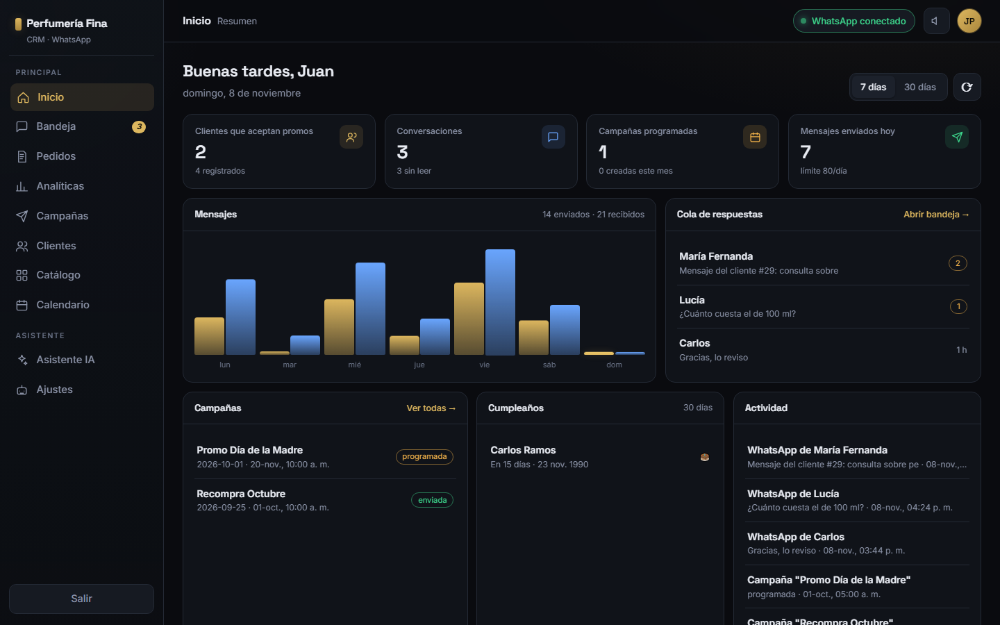
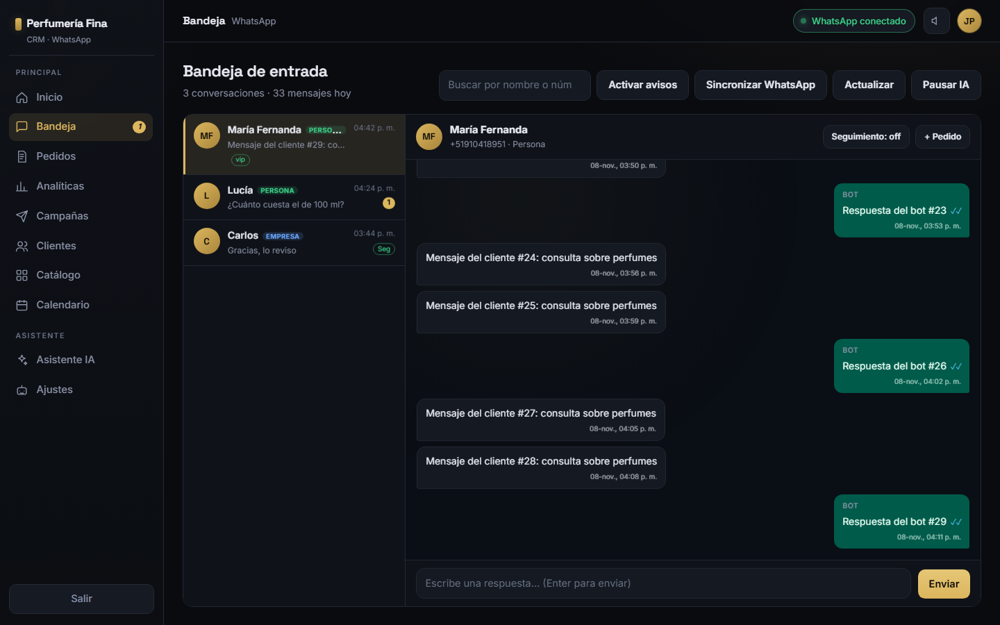
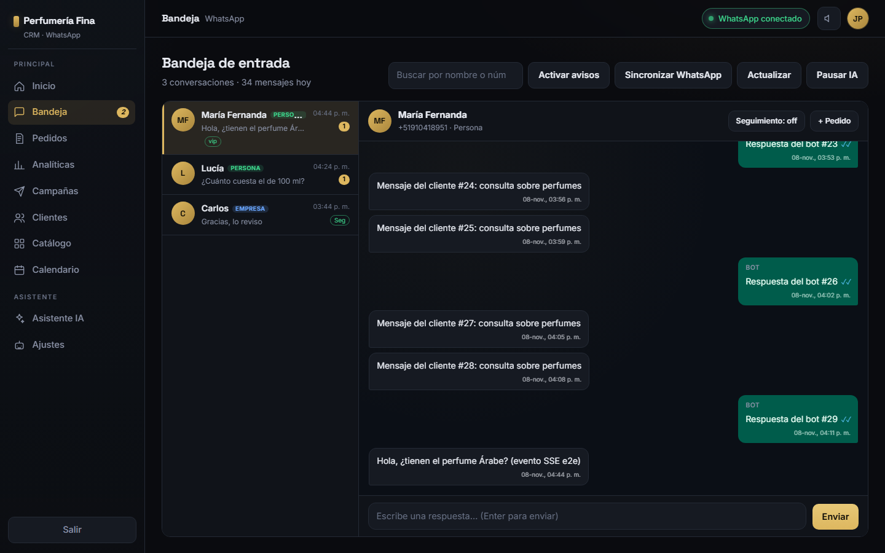

# E2E del panel real — Puppeteer + bot simulado + Supabase interceptado

- **Tarea:** `task-5` (QA e2e del panel con Puppeteer, sin modificar la app).
- **Fecha:** 2026-11-08.
- **Alcance:** probar el `index.html` REAL del repo contra un bot simulado y una Supabase
  interceptada, con un arnés reproducible, y demostrar que el producto no tiene errores de
  consola, no parpadea y se comporta bien ante eventos en tiempo real y fallos de red.
- **Regla respetada:** el arnés no toca código de la app. Solo se escriben
  `scripts/e2e-panel.mjs`, este documento y `docs/auditoria/capturas/`.

---

## 1. Resumen ejecutivo — corrida final

| Bloque | Resultado | Evidencia |
|---|---|---|
| Self-test del arnés (sin navegador) | ✅ **9/9 PASS** | `capturas/e2e-selftest.json` |
| **Corrida E2E real con Chromium** | ✅ **11/11 PASS · 0 FAIL · 0 SKIP · exit 0** | `capturas/e2e-resultado.json` |
| Comando y duración | `node scripts/e2e-panel.mjs` · **40,2 s** (40.246 ms) · Chromium 146 headless 1440×900 | 2026-11-08T21:44:06.482Z → 2026-11-08T21:44:46.729Z |
| `index.html` probado | **`sha256=9f2000f25d4e9e8db53ee67db9b599398e64f42840a6e7433fe9b8086bfc3fab`** · 147.222 bytes · mtime 2026-11-08T21:28:43Z | campo `index` del JSON |
| Entorno | Node **v24.16.0** · Puppeteer **24.38.0** · Chrome for Testing **146.0.7680.31** (win32/x64) | campo `environment` |
| Errores | **0 `console.error` JS · 0 `pageerror`** · 1 aviso de red esperado (fallo simulado `E2E-09` + imágenes offline) | campo `errors` |

Detalle de los 11 casos (copiado del JSON de la corrida final):

```
PASS E2E-01 Arranque limpio: login oculto, app visible, sesión Supabase aceptada
     → sesión=qa.e2e@perfumeriafina.test · 4 de 4 clientes · 2 pueden recibir promociones
PASS E2E-02 Todas las pestañas abren sin excepciones
     → 10 pestañas: inicio, bandeja, pedidos, analiticas, campanas, clientes, catalogo, calendario, ia, bot
PASS E2E-03 Bandeja: lista pintada y chat abierto
     → 3 chats · hilo 30 mensajes
PASS E2E-04 SSE conectado: el panel abre /api/stream
     → url=http://127.0.0.1:3199/api/stream?token= · clientes=1 · peticiones stream=1
PASS E2E-05 Evento SSE "mensaje" se AGREGA al hilo sin remover nodos previos
     → +1 nodo(s), -0, 30/30 previos conservados
PASS E2E-06 Eventos ack/campana/derivación no reemplazan el hilo
     → sin removals · alert-badge "1"
PASS E2E-07 Scroll del hilo se conserva si el usuario está arriba
     → scrollTop 0 → 0 · 31 mensajes conservados
PASS E2E-08 Idle 20 s: sin mutaciones, sin polling de eventos ni recargas
     → 0 mutaciones · 0 eventos · 2 req (conversaciones×1, estado×1) · 0 REST
PASS E2E-09 Fallo de red del bot NO borra la lista ya pintada
     → 3 items intactos · aviso "⚠ Sin conexión con el bot · datos de 02:23 p. m." · recuperada y asentada
PASS E2E-10 TOKEN_REFRESHED de Supabase NO recarga la app ni repite GET REST
     → INITIAL_SESSION, TOKEN_REFRESHED · 0 GET REST · 3 items intactos
PASS E2E-11 Cero errores de consola JS y cero pageerror en toda la corrida
     → 0 console.error JS · 0 pageerror · 1 aviso(s) de red esperados
```

**Cómo se ejecutó:** el arnés es `node scripts/e2e-panel.mjs`. En una sesión de agente con
sandbox de Windows, Chromium **no puede arrancar** (ver §7), así que la corrida final se hizo
desde una ejecución con **permiso de sandbox ampliado**, que es el entorno equivalente a una
terminal normal del usuario. En una PC normal basta el comando de §3.

---

## 2. Requisitos

- Windows, **Node 24** (probado con `v24.16.0`).
- `bot/node_modules/puppeteer` instalado (probado con **Puppeteer 24.38.0**).
- Chromium de Puppeteer instalado:
  `C:\Users\<usuario>\.cache\puppeteer\chrome\win64-146.0.7680.31\chrome-win64\chrome.exe`.
- **No** requiere `npm install` adicional ni red: el `supabase-js` del CDN se sirve desde
  `bot/node_modules/@supabase/supabase-js/dist/umd/supabase.js` (v2.119.0).

Comprobación de Puppeteer/Chromium (paso 1 del arnés): se resolvió con
`createRequire()` apuntando a `bot/package.json` y `puppeteer.executablePath()`:

```powershell
cd bot
node -e "const {createRequire}=require('node:module');const r=createRequire(process.cwd()+'/package.json');const p=r('puppeteer');console.log(p.executablePath())"
# → C:\Users\<usuario>\.cache\puppeteer\chrome\win64-146.0.7680.31\chrome-win64\chrome.exe
```

---

## 3. Comando exacto

Desde la raíz del repo, en una terminal normal del usuario:

```powershell
cd "C:\Users\Juan Pablo\Documents\WEB PROJECTS\Crm Perfumeriafina"
node scripts/e2e-panel.mjs
```

Variantes:

```powershell
node scripts/e2e-panel.mjs --self-test      # valida mock bot + SSE + fixtures sin navegador
node scripts/e2e-panel.mjs --headed         # navegador visible (depurar)
node scripts/e2e-panel.mjs --idle-ms=5000   # acorta la ventana de idle (desarrollo)
```

Salidas:

- Consola: `PASS/FAIL` por caso, totales y motivo de fallo.
- Capturas: `docs/auditoria/capturas/01-inicio.png`, `02-bandeja.png`, `03-bandeja-sse.png`.
- Informe máquina: `docs/auditoria/capturas/e2e-resultado.json` — incluye el **sha256 del
  `index.html` probado**, versiones, peticiones, errores y detalle por caso.
- Parcial incremental: `docs/auditoria/capturas/e2e-parcial.json` (se reescribe tras cada caso;
  si la corrida se interrumpe, deja evidencia de lo ya ejecutado).
- Self-test: `docs/auditoria/capturas/e2e-selftest.json`.

Códigos de salida: `0` = todo PASS · `1` = algún FAIL · `2` = error del arnés ·
`3` = entorno sin navegador (Chromium no arranca).

---

## 4. Cómo funciona el arnés

```
┌──────────────────────────── Chrome (Puppeteer) ───────────────────────────┐
│  http://127.0.0.1:8099/  ← index.html REAL (servido sin modificar)         │
│      localStorage sembrado:                                                │
│        bot_url = http://127.0.0.1:3199                                     │
│        sb-pcesvmsewfpvmqmfmswn-auth-token = {access_token, refresh_token,  │
│                                              expires_at futuro, user}      │
│  fetch() → bot simulado 3199   (CORS habilitado)                           │
│  EventSource → 3199/api/stream?token=...                                   │
│  Supabase → interceptada por CDP con fixtures (no sale a internet)         │
└───────────────────────────────────────────────────────────────────────────┘
         │                              │
         │                              └─ Bot simulado :3199
         │                                   /api/estado, /api/eventos,
         │                                   /api/conversaciones[/:tel[/importar|/leido|/enviar]],
         │                                   /api/pedidos, /api/pagos, /api/ia, /api/ia/pausar,
         │                                   /api/logs, /api/analiticas, /api/estadisticas,
         │                                   /api/qr (PNG 1×1), /api/stream (SSE),
         │                                   /api/clientes, /api/campanas, /api/sincronizar,
         │                                   /api/prueba, /api/seguimiento
         └─ Supabase interceptada: /rest/v1/{clientes,productos,plantillas,campanas,envios}
                                   /auth/v1/token?grant_type=refresh_token, /auth/v1/user
```

### 4.1 SSE (contrato del bot-core, confirmado por el Lead)

`GET /api/stream?token=...` responde `Content-Type: text/event-stream`, escribe `retry: 3000`,
un `: conectado` y luego frames `id: <n>\ndata: {"id","tipo","en",...}\n\n`.

Tipos emitidos por el guion del mock: `hola`, `mensaje`, `ack`, `campana`, `derivacion`
(y helpers para `leido`, `pedido`). El panel usa solo `EventSource.onmessage` (sin `event:` con
nombre), tal como lo implementa el bot-core.

### 4.2 Estado único SSE ⇄ REST (clave para no parpadear)

El mock es **stateful**: un `mensaje` por SSE muta los mismos objetos que sirve el REST
(`ultimoTexto`, `ultimoEn`, `noLeidos`, historial del hilo) y `GET /api/conversaciones` ordena
igual que el bot real (pin y luego `ultimoEn` descendente). Además los eventos usan un
**timestamp fijo** (no "ahora") para que el texto `HH:MM` de la lista no cambie al cruzar el
minuto durante el idle. Con eso, el HTML que compara `fantasma()`/`pintarLista()` es idéntico y
el DOM no se toca (0 mutaciones en idle).

### 4.3 Sesión falsa de Supabase

Storage key por defecto de supabase-js v2: **`sb-pcesvmsewfpvmqmfmswn-auth-token`**.
Se siembra un objeto:

```json
{
  "access_token": "<JWT sintético con exp futuro>",
  "token_type": "bearer",
  "expires_in": 3600,
  "expires_at": "<epoch futuro>",
  "refresh_token": "e2e-refresh-token",
  "user": { "id": "...", "aud": "authenticated", "email": "qa.e2e@perfumeriafina.test", "...": "..." }
}
```

Validado contra el propio supabase-js v2 (`auth.getSession()` devuelve la sesión; caso `ST-07`).

### 4.4 Supabase interceptada (fixtures)

- `GET /rest/v1/clientes` → 4 clientes; `productos` → 4; `plantillas` → 2; `campanas` → 2;
  `envios` → `[]`. Cualquier tabla desconocida → **404 controlado**.
- `POST /auth/v1/token?grant_type=refresh_token` → sesión nueva (para probar `TOKEN_REFRESHED`).
- `GET /auth/v1/user` → usuario.
- Se responde CORS y se atienden preflight `OPTIONS`.
- El `<script src="...supabase.js">` del CDN se sustituye por el UMD local de
  `bot/node_modules` para que la corrida sea **offline y determinista** (ver §9).
- Las imágenes del catálogo (`https://perfumeriafinaperu.com/**`) se sirven como PNG 1×1 para no
  ensuciar la corrida con errores ORB de recursos externos sin red.

### 4.5 Instrumentación inyectada en la página (antes de que corra el panel)

- `EventSource` envuelto para registrar URL, `open`, nº de `message` y errores.
- `MutationObserver` en `#in-list` y `#in-msgs`, contando **solo** nodos `.in-item`/`.msg`
  agregados y removidos (los cambios de palomitas/tick no cuentan).
- Helpers `attach/reset/muts/tag/kept/count/texts/state/markApp/appInfo` para medir sin tocar la app.

---

## 5. Casos y criterios de aceptación (todos PASS)

| ID | Caso | Criterio | Resultado final |
|---|---|---|---|
| `E2E-01` | Arranque limpio | `#login` oculto, `#app` visible, `getSession()` devuelve sesión, `load()` pinta los 4 clientes, 0 errores | ✅ 4 de 4 clientes · sesión aceptada |
| `E2E-02` | Todas las pestañas abren | cada botón de `#tabs` deja visible su `.tab#t-<nombre>` sin error JS | ✅ 10/10 pestañas |
| `E2E-03` | Bandeja pinta y abre chat | ≥3 `.in-item`, hilo visible con ≥20 `.msg` | ✅ 3 chats · 30 mensajes |
| `E2E-04` | SSE conecta | `new EventSource(...)` + cliente registrado en el mock | ✅ 1 cliente · 1 request stream |
| `E2E-05` | **Append sin reemplazo** | evento `mensaje`: +1 nodo, 0 removals, 30/30 previos conservados, texto nuevo presente | ✅ +1 / −0 / 30/30 |
| `E2E-06` | ack/campana/derivación no rompen | 0 removals de `.msg`; badge de alerta responde | ✅ sin removals · badge "1" |
| `E2E-07` | **Scroll conservado si el usuario está arriba** | `scrollTop=0`; llega mensaje; sigue en 0 y 0 removals | ✅ 0 → 0 · 31 mensajes |
| `E2E-08` | **Idle 20 s sin parpadeo** | 0 mutaciones en `#in-list`/`#in-msgs`; 0 `/api/eventos`; ≤2 req/endpoint; 0 GET REST | ✅ 0 mutaciones · 0 eventos · 2 req · 0 REST |
| `E2E-09` | **Fallo de red no borra la lista** | socket cortado en `/api/conversaciones`: mismos 3 `.in-item`, sin "No se pudo cargar", aviso "⚠ Sin conexión…"; recupera | ✅ 3 items intactos · aviso · recuperada |
| `E2E-10` | **TOKEN_REFRESHED no recarga** | `refreshSession()`: evento emitido, `timeOrigin`/marca `#app` intactos, 3/3 items, 0 removals, 0 GET REST | ✅ INITIAL_SESSION+TOKEN_REFRESHED · 0 REST · 3 intactos |
| `E2E-11` | Cero errores | 0 `console.error` JS, 0 `pageerror`; fallo de red inyectado y recursos offline clasificados como esperados | ✅ 0/0 · 1 aviso esperado |

---

## 6. Capturas (corrida final)







---

## 7. Bloqueo del sandbox de agentes (cómo se resolvió)

En la sesión del agente (política `workspace-write` en Windows) Chromium **no puede arrancar**:

- `puppeteer.launch()` → `spawn EPERM` (el sandbox no permite los pipes de stdio).
- Chrome lanzado a mano → `FATAL:mojo\public\cpp\platform\platform_channel.cc:108 Check failed: . : Acceso denegado. (0x5)`.
- Playwright WebKit → `spawn EPERM` (`--inspector-pipe`).

El arnés detecta esto, imprime el diagnóstico y sale con **código 3** (nunca falsea un PASS).
La corrida final se hizo desde una ejecución **con permiso de sandbox ampliado** (equivalente a
una terminal normal del usuario), donde Chromium arranca sin problemas. En una PC normal el
comando de §3 funciona directamente.

---

## 8. Hallazgos

**No se encontraron bugs en el panel.** Los 11 casos pasan sobre el `index.html` final
(`sha256=9f2000f2…`), en particular los comportamientos anti-parpadeo:

- SSE de mensaje se **agrega** al hilo (0 nodos removidos, 30/30 previos conservados).
- Scroll anclado al fondo solo si el usuario ya estaba abajo; si está arriba, no se mueve.
- Idle de 20 s: 0 mutaciones en lista e hilo, 0 polling a `/api/eventos` con SSE abierto,
  0 recargas REST.
- Fallo de red del bot: la lista ya pintada se conserva y se avisa "⚠ Sin conexión…".
- `TOKEN_REFRESHED` no dispara `load()` ni re-renderiza la app.

Durante el desarrollo del arnés se encontraron y corrigieron **dos bugs del propio arnés**
(no del panel), que vale la pena registrar por transparencia:

1. El mock no actualizaba el estado que servía el REST tras un evento SSE (y devolvía el orden
   de chats sin ordenar), lo que provocaba un repintado real del panel al hacer polling. Se hizo
   **stateful** y ordenado como el bot real (`E2E-08`, `E2E-10`).
2. El helper de conteo del arnés se llamaba una vez con un solo argumento y generaba el selector
   `"… undefined"`, devolviendo 0 en silencio; eso hizo fallar `E2E-10` aunque el DOM estaba
   intacto. Se corrigió la llamada y se endureció el helper (`NS.count`/`NS.texts` aceptan
   selector combinado).

---

## 9. Limitaciones (lo que el mock NO cubre)

1. **Supabase real:** no se prueba RLS, base de datos real, bucket de comprobantes ni el
   endpoint real de auth. Los fixtures imitan la forma de los datos, no la lógica del backend.
2. **WhatsApp real:** el bot está simulado; no se prueba `whatsapp-web.js`, ni el QR real, ni
   media (audios/fotos/comprobantes), ni la entrega/lectura real de WhatsApp.
3. **Login real:** la sesión se siembra en `localStorage`; no se prueba el formulario de login
   contra Supabase. Sí se prueba que el panel ignora `INITIAL_SESSION`/`TOKEN_REFRESHED` y que
   `getSession()` acepta la sesión.
4. **CDN de supabase-js:** se sirve el UMD local **v2.119.0** en lugar del 2.45.4 del CDN. La API
   usada (`createClient`, `auth.getSession`, `onAuthStateChange`, `from`) es la misma. Si el
   `index.html` añadiera `integrity="sha384-…"` al `<script>`, la sustitución fallaría por SRI;
   hoy no lo tiene.
5. **Ventana/runtime:** se prueba en Chromium headless 1440×900; no en móvil, ni Safari/Firefox.
6. **Tiempo real real:** el SSE del mock emite datos controlados; no se prueba el orden ni la
   reconexión real del bot (el panel sí reconecta con backoff, no se ejercita a fondo).
7. **Sandbox de agentes:** requiere permiso ampliado (ver §7); en una terminal normal no.
8. **Datos de fecha:** los fixtures usan fechas fijas alrededor del 2026-11 para que la UI sea
   determinista; el panel real trabaja con fechas de producción.

---

## 10. Reproducibilidad y mantenimiento

- El `index.html` se sirve **sin tocarlo** en cada petición; al empezar la corrida se registra su
  `sha256`, tamaño y `mtime` en `e2e-resultado.json` para saber exactamente qué versión se probó.
  Corrida final: **`sha256=9f2000f25d4e9e8db53ee67db9b599398e64f42840a6e7433fe9b8086bfc3fab`**,
  147.222 bytes.
- Si el panel cambia de IDs/endpoints, el arnés falla con un mensaje claro (p. ej. "no existe
  `#t-<tab>`", "no se observó `new EventSource()`", "el hilo no se abrió con mensajes").
- Si el contrato SSE cambia (tipos/campos), actualizar `createBotMock()` y `ST-05`.
- Para CI: `node scripts/e2e-panel.mjs` devuelve `0` solo si los 11 casos pasan; el JSON permite
  publicar el detalle.
- Artefactos versionables de la corrida final:
  - `capturas/e2e-resultado.json` (resultado completo)
  - `capturas/e2e-selftest.json` (9/9 self-test)
  - `capturas/01-inicio.png`, `02-bandeja.png`, `03-bandeja-sse.png`

